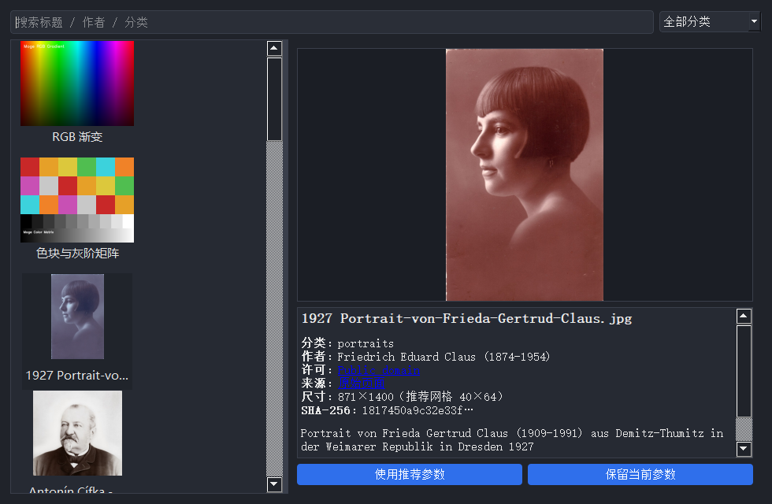

# Moge（墨格）2.0

像素艺术 / Minecraft 方块画 / 拼豆图纸的本地桌面工作台，基于 PyQt5 + NumPy + OpenCV。


## 功能

- **普通像素化**：块均值 / 块频数 / 最近像素采样，RGB/Lab K-Means、MiniBatch、Ward 合并，颜色数控制、固定种子、孤立色块清理。
- **Minecraft 方块画**：可在“版本资源管理”中自动获取 Mojang 官方 Java 客户端 JAR 与 Bedrock 官方样例资源，解析真实 blockstate/model/texture（Java）与 terrain_texture/blocks.json（Bedrock）；按 Java/基岩、精确版本、材质类别、获取条件、成本等级、朝向、透明/重力限制筛选；结果 100% 合法；支持用户资源包 ZIP（只读，取贴图平均色）与筛选诊断。
- **拼豆图纸**：SQLite 品牌色卡（缺失时回退内置近似色卡）与用户 CSV 色卡；品牌/系列隔离、库存 CSV、禁用色号、颜色数量统计、底板分页、采购包数（每包数量可配置）与 PDF/CSV 导出；左侧仅显示色卡摘要，完整来源与可信度见“色卡详情”；拼豆模式默认只看已用颜色，可切换全部颜色。
- **工作台**：启动进入欢迎页，可打开图片、恢复工程或进入示例图库；三模式切换保留源图，可缩放/平移/网格叠层画布，原图对比、重置视图、坐标定位，画笔/填充/吸管/替换/撤销/重做，浅色/深色主题，后台任务进度与取消，任务 ID 防止旧结果覆盖。
- **示例图库**：内置 19 张开放许可示例图（人物、动物、风景、花卉、建筑、插画、透明图与合成测试图），支持分类、搜索、缩略图预览、许可信息与推荐网格，双击即可加载到当前模式。
- **调色板**：搜索、按用量/名称/色相排序、已用颜色/全部颜色切换；无图片时也可浏览品牌色卡；调色板与统计侧栏可收起。
- **高 DPI**：自适应启动尺寸，100% / 125% / 150% 缩放下三栏可用。
- **导出**：PNG/JPEG、材料 CSV、分页图纸 PDF、`.moge` 工程保存/回读。

## 环境要求

- Windows 10/11
- Python 3.9+（CI 覆盖 3.9 / 3.11）

## 安装与运行

```powershell
python -m venv .venv
.venv\Scripts\activate
pip install -e ".[dev]"

python main.py
# 或安装后
moge
```

日志写入 `%LOCALAPPDATA%\Moge\logs\app.log`。

## 使用要点

1. 启动后在欢迎页选择“打开图片”“打开工程”或“使用示例图片”，也可直接拖入图片；左侧设置网格宽高（与源图像素尺寸解耦）。
2. 示例图库中可按分类或关键字筛选，双击缩略图直接加载；也可选择“使用推荐参数”或“保留当前参数”。
3. 选择模式与参数，点击“执行处理”（`Ctrl+Enter`）。处理期间可取消。
4. 右侧选择颜色/材料后可编辑画布；`B/G/I/E/R` 切换画笔/填充/吸管/橡皮擦/替换同类。
5. 文件菜单导出 PNG/CSV/PDF 或保存 `.moge` 工程；保存工程与导出成品是分开的。

### 内置示例图库



- 仓库内置 19 张示例图：人物 3、动物 3、风景 3、花卉 2、建筑 2、插画 2、透明图 2、合成测试图 2。
- 均为 CC0 / Public Domain / CC BY 许可，逐张记录作者、原始页面、许可链接与 SHA-256；完整清单见 [assets/samples/CREDITS.md](assets/samples/CREDITS.md) 与 `assets/samples/manifest.json`。
- 图库完全离线读取本地资源，开发环境使用 `assets/samples`，PyInstaller 环境使用 `sys._MEIPASS/assets`。
- 重新获取或更新图片：

```powershell
python scripts/fetch_sample_images.py
```

- 图片与许可独立于 Moge 软件许可；下载后可能等比缩放至长边不超过 1400 像素，并生成缩略图，不做内容裁剪或重新上色。

### Minecraft 资源包

- 已实测 Java 1.12.2 / 1.16.5 / 1.18.2 / 1.20.1 / 1.21.4 与 Bedrock 1.20.0 / 1.20.80 / 1.21.0 / 1.21.50；数据保存在 `%LOCALAPPDATA%\Moge\resources`，不进入 Git 仓库。
- 命令行入口：

```powershell
python -m Moge.core.resources.cli list --edition java --limit 20
python -m Moge.core.resources.cli fetch --edition java --version 1.20.1
python -m Moge.core.resources.cli fetch --edition bedrock --version 1.20.80
python -m Moge.core.resources.cli fetch-range --start 1.20 --end 1.20.2 --dry-run
python -m Moge.core.resources.cli verify --edition java --version 1.20.1 --full
python -m Moge.core.resources.cli report
```

- Bedrock 目标 Release 可能没有附件，系统会回退到 Mojang 官方 tag 源码归档，并在报告中标注该来源与摘要限制。
- 仓库不包含 Minecraft 原版贴图；仅在本机缓存，不自动提交或上传。

### 拼豆色卡 CSV

必需列：`brand,series,code,name,rgb`；可选：`availability,source,revision,product_line,verified`。同品牌/系列色号必须唯一。

## 测试与基准

```powershell
ruff check .
pytest --cov=Moge.core --cov-report=term-missing
python tools/run_benchmarks.py
```

示例图库测试覆盖 manifest 条目与 SHA-256、许可白名单、透明通道、推荐网格、PyInstaller 资源路径以及欢迎页/图库/三模式 GUI 加载。

基准输出：`benchmarks/results.json` 与 [docs/Clustering-Benchmarks.md](docs/Clustering-Benchmarks.md)。

## 打包

```powershell
pyinstaller --noconfirm Moge.spec
```

产物位于 `dist/Moge`。`assets/samples` 会一并打入 `dist/Moge/_internal/assets/samples`，示例图库在断网环境仍可用。

## 版权与数据声明

- 仓库不包含 Minecraft 原版贴图与官方拼豆色卡数据文件。
- `assets/samples` 内的示例图来自 Wikimedia Commons，按 CC0 / Public Domain / CC BY 单独授权，署名与许可见 [assets/samples/CREDITS.md](assets/samples/CREDITS.md)；图片许可独立于软件许可。
- 拼豆色卡来自 SQLite 数据库（`%LOCALAPPDATA%\Moge\palettes\beads.db`），公开 RGB 为屏幕参考值，不等于品牌官方实物测量色；界面与导出会显示来源、许可（MIT）与可信度。
- 内置 Minecraft 色值为**屏幕近似且未验证**，仅用于演示与匹配；请以实际材料为准。
- 用户导入的图片、资源包、色卡仅在本机处理，不上传。

## 文档

- [架构说明](docs/Moge-2.0-Architecture.md)
- [Minecraft 资源与筛选](docs/Minecraft-Assets-And-Filtering.md)
- [Minecraft 资源获取与索引报告](docs/minecraft-resource-acquisition-report.md)
- [拼豆色卡与图纸](docs/Beads-Palette-And-Blueprints.md)
- [拼豆色卡自动获取与数据库集成报告](docs/bead-palette-acquisition-report.md)
- [内置示例图库验收报告](docs/sample-image-library-report.md)
- [聚类与复合管线基准](docs/Clustering-Benchmarks.md)
- [验收记录](docs/Moge-2.0-Acceptance.md)
- [第二轮界面与功能优化报告](docs/Moge-2.0-Round2-Optimization.md)
- [变更记录](docs/Moge-2.0-ChangeLog.md)

## 许可

Apache-2.0，详见 LICENSE。
