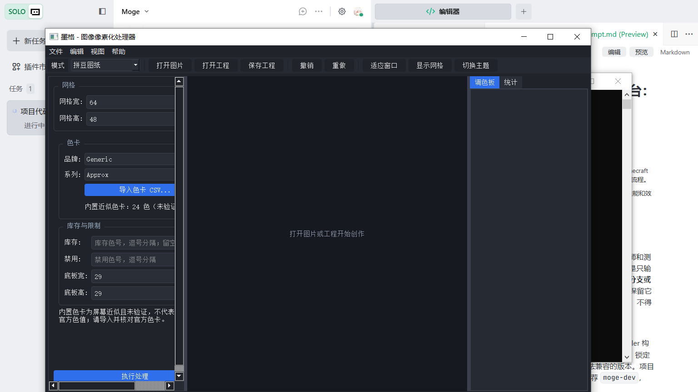

# Moge（墨格）2.0

像素艺术 / Minecraft 方块画 / 拼豆图纸的本地桌面工作台，基于 PyQt5 + NumPy + OpenCV。



## 功能

- **普通像素化**：块均值 / 块频数 / 最近像素采样，RGB/Lab K-Means、MiniBatch、Ward 合并，颜色数控制、固定种子、孤立色块清理。
- **Minecraft 方块画**：内置近似方块库，按 Java/基岩、精确版本、材质类别、获取条件、成本等级、朝向、透明/重力限制筛选；结果 100% 合法；支持用户资源包 ZIP（只读，取贴图平均色）；提供筛选诊断。
- **拼豆图纸**：内置近似色卡与用户 CSV 色卡；品牌/系列隔离、库存 CSV、禁用色号、颜色数量统计、底板分页、采购包数（每包数量可配置）与 PDF/CSV 导出；默认只显示已用颜色。
- **工作台**：三模式切换保留源图，可缩放/平移/网格叠层画布，原图对比、重置视图、坐标定位，画笔/填充/吸管/替换/撤销/重做，浅色/深色主题，后台任务进度与取消，任务 ID 防止旧结果覆盖。
- **调色板**：搜索、按用量/名称/色相排序、仅显示已用颜色/材料；调色板与统计侧栏可收起。
- **高 DPI**：自适应启动尺寸，100% / 125% / 150% 缩放下三栏可用。
- **导出**：PNG/JPEG、材料 CSV、分页图纸 PDF、`.moge` 工程保存/回读。

## 环境要求

- Windows 10/11
- Python 3.9+（CI 覆盖 3.9 / 3.11）

## 安装与运行

```powershell
python -m venv .venv
.venv\Scripts\activate
pip install -e ".[dev]"

python main.py
# 或安装后
moge
```

日志写入 `%LOCALAPPDATA%\Moge\logs\app.log`。

## 使用要点

1. 打开/拖入图片；左侧设置网格宽高（与源图像素尺寸解耦）。
2. 选择模式与参数，点击“执行处理”（`Ctrl+Enter`）。处理期间可取消。
3. 右侧选择颜色/材料后可编辑画布；`B/G/I/E/R` 切换画笔/填充/吸管/橡皮擦/替换同类。
4. 文件菜单导出 PNG/CSV/PDF 或保存 `.moge` 工程；保存工程与导出成品是分开的。

### Minecraft 资源包

- 只支持 Java 版资源包 ZIP；读取 `assets/minecraft/textures/block/*.png` 的平均色。
- 不复制、不上传任何游戏资产；仓库不包含原版贴图。
- 资源包只影响颜色近似，不解析模型、多面贴图或生物群系染色。

### 拼豆色卡 CSV

必需列：`brand,series,code,name,rgb`；可选：`availability,source,revision,product_line,verified`。同品牌/系列色号必须唯一。

## 测试与基准

```powershell
ruff check .
pytest --cov=Moge.core --cov-report=term-missing
python tools/run_benchmarks.py
```

基准输出：`benchmarks/results.json` 与 [docs/Clustering-Benchmarks.md](docs/Clustering-Benchmarks.md)。

## 打包

```powershell
pyinstaller --noconfirm Moge.spec
```

产物位于 `dist/Moge`。

## 版权与数据声明

- 仓库不包含 Minecraft 原版贴图、官方拼豆色卡或其它受版权保护的素材。
- 内置 Minecraft/拼豆色值为**屏幕近似且未验证**，仅用于演示与匹配；请以实际材料为准。
- 用户导入的图片、资源包、色卡仅在本机处理，不上传。

## 文档

- [架构说明](docs/Moge-2.0-Architecture.md)
- [Minecraft 资源与筛选](docs/Minecraft-Assets-And-Filtering.md)
- [拼豆色卡与图纸](docs/Beads-Palette-And-Blueprints.md)
- [聚类与复合管线基准](docs/Clustering-Benchmarks.md)
- [验收记录](docs/Moge-2.0-Acceptance.md)
- [第二轮界面与功能优化报告](docs/Moge-2.0-Round2-Optimization.md)
- [变更记录](docs/Moge-2.0-ChangeLog.md)

## 许可

Apache-2.0，详见 LICENSE。
